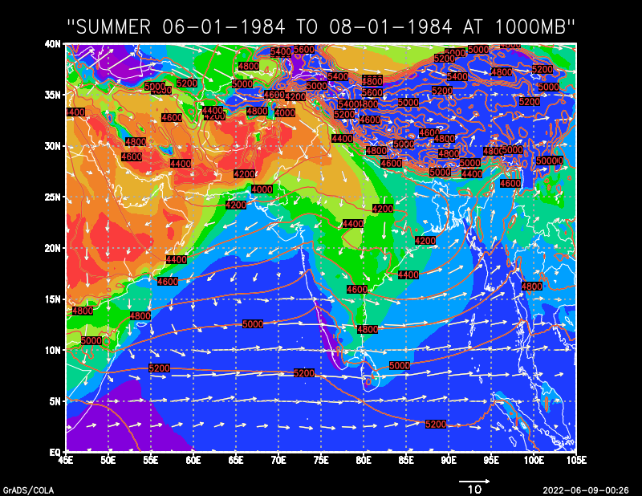
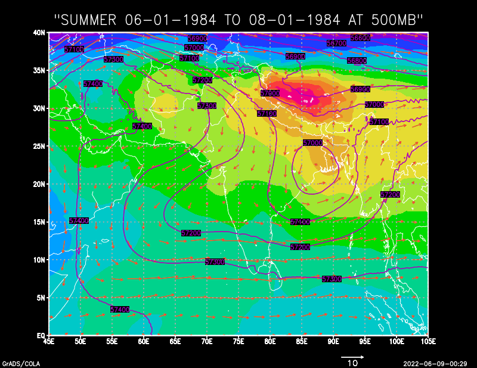
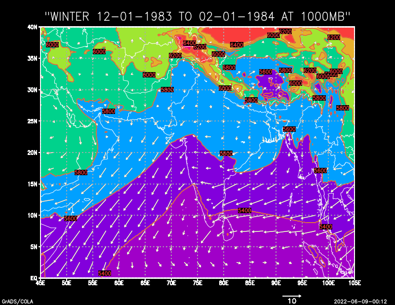
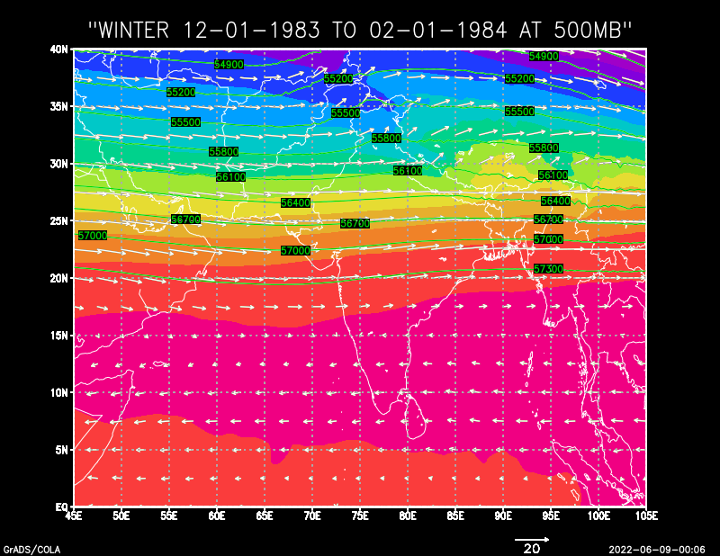

# South Asian Monsoon Circulation: Summer vs. Winter (GrADS)

Maps of **temperature, winds and geopotential height** over South Asia and the northern
Indian Ocean, comparing the **summer monsoon (June–August 1984)** with **winter (December 1983 –
February 1984)**. Each season is shown near the surface (**1000 hPa**) and in the mid-atmosphere
(**500 hPa**). Data is ERA reanalysis from ECMWF, plotted with **GrADS**.

Lab work for *Dynamic Meteorology*, BS Space Science, Institute of Space Technology (2022).
By **Muhammad Arbab Tahir**.

## What the maps show

- **Shading:** air temperature
- **Arrows:** wind direction and speed
- **Lines:** geopotential height, the height of the pressure level in metres. Highs and lows in
  these lines show high- and low-pressure systems.
- **Area:** 0–45° N, 45–105° E (Arabian Peninsula to Southeast Asia)

| | 1000 hPa (near the surface) | 500 hPa (about 5.5 km up) |
|---|---|---|
| **Summer** (Jun–Aug 1984) |  |  |
| **Winter** (Dec 1983 – Feb 1984) |  |  |

## Findings

**Summer**
- **Near the surface,** strong **south-westerly winds** blow from the Arabian Sea and Bay of Bengal
  onto the Indian subcontinent. This is the **summer monsoon** that brings the rains.
- The land, especially Pakistan, north-west India and Arabia, is much **hotter** than the ocean.
  This land–sea temperature contrast drives the monsoon.
- **At 500 hPa,** a large **high-pressure system sits over the Tibetan Plateau** (the Tibetan High),
  with winds circulating around it.

**Winter**
- **Near the surface,** the winds **reverse** and blow from the north-east, off the cold land and
  out to sea. This is the **winter (north-east) monsoon**.
- **At 500 hPa,** the height lines are packed closely across the north and the winds blow
  steadily **from the west**. This shows the strong **westerly flow** that brings winter weather
  systems to Pakistan and north India.

## How the maps were made

The steps in GrADS, saved as the script [plot_level.gs](plot_level.gs):

```
sdfopen <ERA file>.nc            open the NetCDF data
set mpdset hires                 high-resolution coastlines
set gxout shaded                 shaded colours
set lat 0 45
set lon 45 105
d t-273.15                       temperature in °C
define zon=u
define mer=v
d skip(zon,10,10); skip(mer,10,10)   wind arrows (every 10th point)
set gxout contour
d z                              geopotential height lines
run xcbar                        colour bar
draw title <title>
```

Run it in GrADS with:
```
run plot_level.gs ERA_Summer_JUN-AUG_84.nc SUMMER_500MB summer-500hpa.png
```

## Data
ERA reanalysis (ECMWF) averaged over each season. Similar data is freely available from the
[Copernicus Climate Data Store (ERA5)](https://cds.climate.copernicus.eu/).
`xcbar.gs` is a widely used free GrADS colour-bar script and is not included here.

## Tools
GrADS · ERA reanalysis (ECMWF) · NetCDF
